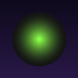
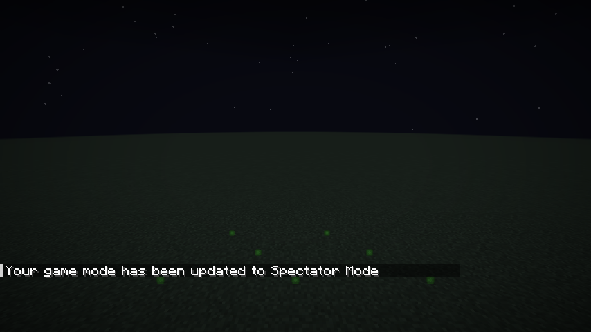
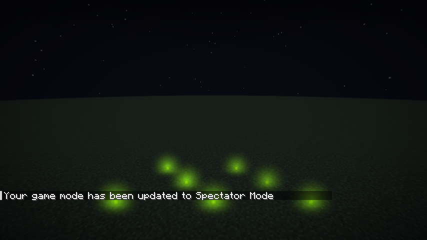
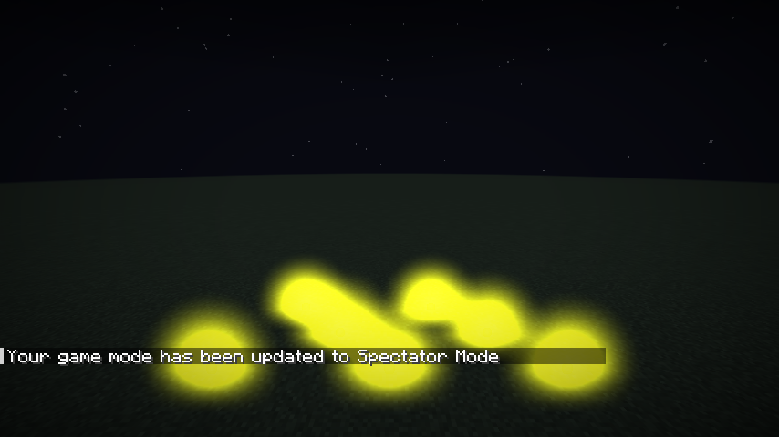
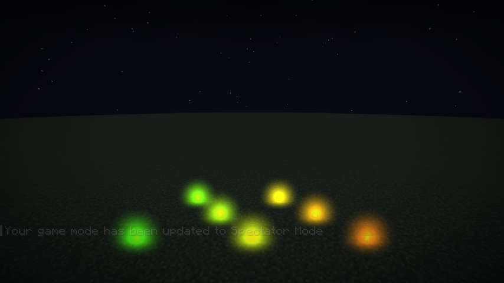
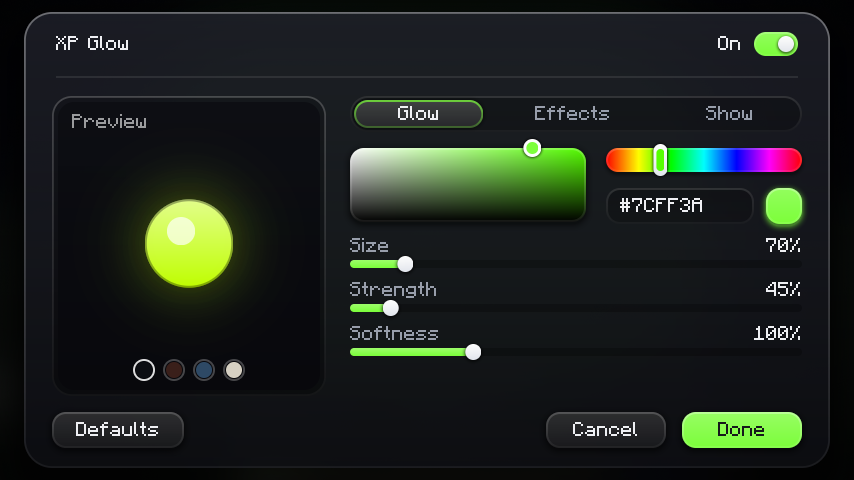

# XP Glow

experience orbs glow with a cheap shader glow. every orb shines in its own green and yellow, or in the color you pick.

client side fabric mod for 1.21.11, 26.1 and 26.2. press **O** to open the settings (press it again to close, rebind it in Controls), or use Mod Menu. the settings menu is built into the mod, it only needs fabric api. color picker with hex field, a live preview, sliders and switches.

- **orb colors**: the glow takes the green and yellow color the orb shows
- **color**: any color
- **size**: how big the glow is (10% to 500%)
- **strength**: how bright it is (0% to 500%), above 100% it gets brighter than normal
- **softness**: wide and soft or small and tight
- **blend**: add (brighter, can burn out) or screen (gentler)
- **effect**: static, pulse, flicker, rainbow or shimmer, with a speed slider
- **range** and **max glows**: how far away and how many glows get drawn, lower is faster

## download

| jar | minecraft |
|---|---|
| `xp-glow-mc1.21.11-1.1.0.jar` | 1.21.11 |
| `xp-glow-mc26.1-1.1.0.jar` | 26.1 |
| `xp-glow-mc26.2-1.1.0.jar` | 26.2 |

on the releases page. fabric loader 0.16 or newer, fabric api.

## pictures

| off | on |
|---|---|
|  |  |

| strong | rainbow |
|---|---|
|  |  |

## why it does not lag

- the whole glow is one draw call with one small shader. there are no extra screen copies, no blur passes and no extra textures
- nothing is drawn when there is nothing in range, and the mod does no work when it is switched off
- glows behind you, too far away or too small on the screen are skipped, and only the closest ones up to the max glows setting are kept
- the glow is hidden behind blocks by reading the depth of the scene, so walls block it

## how it works

the orbs are read from the entities of the world each frame. a mixin at the end of the world rendering turns every glow into a camera facing soft disc, all discs are drawn together with additive (or screen) blending over the finished world, before your hand and the interface.

all rights reserved. made by wysss.
